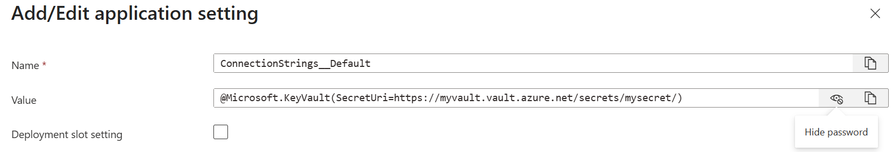

# 02. .NET 애플리케이션과 Key Vault 연동

> **PPT 전환용 설명 원고**입니다. 명령·전체 소스·실습 정리는 [모듈 2 실습](../labs/02-dotnet-integration/README.md)에 있습니다.  
> 기준: .NET 10 ASP.NET Core 웹 앱 / .NET Framework 4.8 콘솔 앱, Azure Public Cloud  
> 기반 자료: [설정 공급자](https://learn.microsoft.com/aspnet/core/security/key-vault-configuration?view=aspnetcore-10.0), [인증 체인](https://learn.microsoft.com/dotnet/azure/sdk/authentication/credential-chains), [플랫폼 참조](https://learn.microsoft.com/azure/app-service/app-service-key-vault-references)

**진행 순서:** 인증·DefaultAzureCredential → Configuration(방법 A) → 직접 조회(방법 B) → 플랫폼 참조(방법 C, 개념만) → 갱신·캐싱 → 환경별 구성 → 버전 → 오류 대응. 실습은 같은 1~7절 번호를 따르되 플랫폼 참조·Azure 배포·플랫폼 갱신 부분을 제외하고, 사전 점검은 0절로 분리합니다.

**워크숍 전제:** 고객은 본인 Azure 구독 없이 강사가 제공한 Vault와 읽기 전용 SP를 사용합니다. **DefaultAzureCredential 전용 실습만 해당 체인을 사용**하고, 나머지 SDK 실습은 `ClientSecretCredential`로 SP 인증을 명시합니다. 앱은 고객 PC에서 실행합니다. 플랫폼 Reference와 Azure 호스팅·배포는 개념으로만 설명하며 실습하지 않습니다.

## 1. 큰 그림 — 앱이 Key Vault를 사용하는 방식

### 1.1 무엇을 보관하는가?

| 객체 | 대표 용도 | 앱의 사용 방식 |
|---|---|---|
| Secret | 연결 문자열, API 키, 패스워드 | 값을 가져와 사용 |
| Key | 암호화 키 | 암복호화·서명·키 보호 연산 요청 |
| Certificate | TLS 인증서와 연결된 키·Secret | 서비스에 인증서를 적용하고 수명 관리 |

이 모듈의 실습은 **Secret을 애플리케이션 설정으로 사용하는 방법**에 집중합니다.

### 1.2 앱이 가져올 것인가, 플랫폼이 전달할 것인가?

```text
직접 SDK 경로
앱 → Azure.Identity로 토큰 획득 → SecretClient / 설정 공급자 → Key Vault

플랫폼 참조 경로
App Service / Functions / Container Apps → Managed Identity로 Key Vault 조회
                                      → 앱에 일반 설정·환경 변수로 전달
```

설정 공급자도 내부적으로 Azure SDK를 사용하는 앱 측 연동입니다. 반면 플랫폼 참조는 호스팅 플랫폼이 Secret을 해석합니다. 앱이 이미 해당 환경 변수/설정을 읽도록 구현되어 있다면 **Key Vault를 위한 코드 변경이 필요 없습니다.** 아무 설정도 읽지 않던 앱에 기능이 자동 추가되는 것은 아닙니다.

| 플랫폼 | 참조 설정 | 앱에서 읽기 |
|---|---|---|
| App Service / Functions | `@Microsoft.KeyVault(SecretUri=https://<vault>.vault.azure.net/secrets/<name>)` | 기존 앱 설정 또는 연결 문자열 |
| Container Apps | 앱 Secret에 `keyVaultUrl`과 `identity` 지정. CLI는 `keyvaultref:...,identityref:...` | 환경 변수를 `secretref:<앱-secret-name>`으로 연결 |

**Container Apps에 `@Microsoft.KeyVault(...)` 문자열을 그대로 넣는 방식은 아닙니다.** 목적은 같지만 설정 문법과 갱신 방식은 플랫폼별로 다릅니다.

### 1.3 책임 경계

| 담당 | 책임 |
|---|---|
| 인프라·플랫폼 담당자 | Vault, 앱의 Managed Identity, 데이터 읽기 권한, 네트워크 경로, 환경별 구성 |
| 개발자 | 조회 방식 선택, 설정 바인딩, 갱신·캐시·오류 처리, 값 없는 로그 |
| 비밀 소유자 | 실제 DB/API 자격 증명 발급·교체·폐기, Vault 값과의 일치 |

앱은 필요한 값을 **읽어 사용**합니다. 인프라 관리 권한과 Secret 쓰기·삭제 권한을 일반 앱에 함께 주지 않습니다.

## 2. 인증과 권한 — 가장 먼저 확인할 부분

### 2.1 Managed Identity는 앱의 암호 관리를 없애는 신원

```text
Azure 앱 + Managed Identity → Microsoft Entra ID 토큰 → Key Vault
```

Microsoft Entra ID는 이전 명칭으로 Azure AD입니다. Managed Identity는 플랫폼이 앱 인증용 자격 증명을 관리하므로, 개발자가 Client Secret을 코드나 설정에 저장하지 않아도 됩니다. **신원을 켜는 것과 Vault 읽기 권한 부여는 별도 작업**입니다.

| 비교 | 시스템 할당 | 사용자 할당 |
|---|---|---|
| 생성·수명 | 앱 리소스에 종속. 앱 삭제 시 신원도 삭제 | 별도 Azure 리소스로 생성·관리 |
| 연결 | 해당 리소스만 사용 | 여러 리소스에 연결 가능 |
| 적합한 상황 | 단일 앱, 신원과 앱의 수명을 함께 관리 | 앱 생성 전 권한 준비, 재배포 시 안정된 신원 유지 |
| 주의 | 앱 재생성 시 Principal ID가 달라질 수 있음 | 공유 범위를 넓히면 권한·감사 경계도 함께 넓어짐 |

사용자 할당 신원을 미리 준비하면 앱 생성 전에 권한을 부여할 수 있습니다. 단순한 첫 데모에서는 시스템 할당으로 흐름을 설명할 수 있으며, 실제 선택은 수명·배포·격리 요구로 결정합니다.

### 2.2 DefaultAzureCredential의 동작 순서

**실습 연결:** [2.2 DefaultAzureCredential 접근](../labs/02-dotnet-integration/README.md#default-credential-net48)

`DefaultAzureCredential`은 “로컬이면 CLI, Azure이면 MI”라는 단순한 분기문이 아니라 **여러 인증 수단을 순서대로 시도하는 체인**입니다.

| 순서 | 인증 수단 | 의미 |
|---|---|---|
| 1 | EnvironmentCredential | 환경 변수의 SP 정보 등이 준비되면 사용 |
| 2 | WorkloadIdentityCredential | 연합 토큰이 구성된 실행 환경 |
| 3 | ManagedIdentityCredential | MI가 활성화된 Azure 호스트 |
| 4 | VisualStudioCredential | Visual Studio의 로그인 계정 |
| 5 | VisualStudioCodeCredential | 지원 확장·Broker 패키지 등 조건 필요 |
| 6 | AzureCliCredential | `az login` 계정 |
| 7 | AzurePowerShellCredential | Azure PowerShell 로그인 |
| 8 | AzureDeveloperCliCredential | `azd auth login` 계정 |
| 선택 | 브라우저 / Broker | 브라우저는 기본 제외. Broker는 추가 패키지 등 조건 필요 |

일반적인 개발 PC에서는 Visual Studio나 CLI 계정을, Azure에서는 Managed Identity를 사용할 수 있습니다. **이번 DefaultAzureCredential 실습의 고객 기본 경로는 제공받은 SP 환경 변수**입니다. 개인 계정·MI 비교는 환경이 준비된 강사/참가자의 선택 항목입니다. SP 인증이 실패했다고 항상 CLI로 넘어가는 것은 아닙니다.

**DefaultAzureCredential 전용 실습에서만** `AZURE_TOKEN_CREDENTIALS`로 체인을 제한합니다. 고객은 `EnvironmentCredential`을 사용합니다. 다른 SDK 실습은 이 selector와 무관하게 `ClientSecretCredential`을 사용하며 로그인 계정으로 대체하지 않습니다. 운영에서는 지원 호스트의 명시적인 ManagedIdentityCredential 등으로 비밀 관리를 줄이는 방식을 별도로 검토합니다.

### 2.3 로컬에서 인증이 안 될 때

| 확인 항목 | 점검 내용 |
|---|---|
| 같은 실행 환경인가? | Windows 앱은 Windows CLI 로그인 상태 확인. WSL 로그인과 자동 공유되지 않음 |
| 같은 테넌트·계정인가? | Visual Studio 로그인과 CLI 로그인이 다를 수 있음 |
| 다른 인증이 먼저 선택됐는가? | `AZURE_CLIENT_ID`, `AZURE_CLIENT_SECRET`, `AZURE_TENANT_ID` 잔여 설정 확인 |
| CLI만 설치했는가? | CLI 설치와 `az login` 완료는 다름 |
| Azure 호스트에서 MI가 켜져 있는가? | 앱의 Identity 설정과 연결된 신원 확인 |
| 토큰 이후 단계는 가능한가? | 데이터 역할과 Vault 방화벽·Private Endpoint 경로 별도 확인 |

오류 진단 시 자격 증명·토큰·원본 Secret 값을 로그에 추가하지 않습니다. 이번 Configuration·직접 조회 시연은 이해를 위해 **가상 교육용 값만** 콘솔·로컬 웹 응답에 표시합니다.

## 3. .NET 코드 레벨 사용법

### 3.1 패키지와 런타임

| 패키지 | 역할 |
|---|---|
| `Azure.Identity` | SP의 ClientSecretCredential, 별도 체인 실습의 DefaultAzureCredential |
| `Azure.Security.KeyVault.Secrets` | SecretClient 직접 조회 |
| `Azure.Extensions.AspNetCore.Configuration.Secrets` | Key Vault를 IConfiguration 공급자로 연결 |

**.NET 10 웹 앱**은 `WebApplication.CreateBuilder()`를 사용합니다. **Framework 4.8 콘솔 실습**은 Generic Host와 같은 설정·옵션 라이브러리를 사용합니다. Framework에서 ASP.NET Core 웹 런타임을 실행하는 예제는 아닙니다. 기존 ASP.NET Framework 웹 앱에 적용할 때는 앱 시작·수명·DI 구성을 별도로 맞춥니다.

예제의 설정 원본은 [Lab 2 상위 폴더의 appsettings.json](../labs/02-dotnet-integration/appsettings.json) 한 개입니다. 두 프로젝트에서 공유하며 빌드·게시 시 실행 폴더로 복사합니다.

### 3.2 방법 A — Configuration 통합

**실습 연결:** [3.2 방법 A — Configuration 통합](../labs/02-dotnet-integration/README.md#configuration)

**일반적인 ASP.NET Core 설정 연동에 권장**합니다. 기존 설정 접근 코드를 유지하면서 공급자를 추가합니다.

```csharp
var credential = new ClientSecretCredential(
    Environment.GetEnvironmentVariable("AZURE_TENANT_ID"),
    Environment.GetEnvironmentVariable("AZURE_CLIENT_ID"),
    Environment.GetEnvironmentVariable("AZURE_CLIENT_SECRET"));

builder.Configuration.AddAzureKeyVault(
    new Uri(vaultUri),
    credential,
    new AzureKeyVaultConfigurationOptions
    {
        ReloadInterval = TimeSpan.FromSeconds(15)
    });
```

15초는 **변경을 빨리 관찰하기 위한 실습값**입니다. 운영 권장 주기로 일반화하지 않습니다.

```csharp
IConfiguration configuration = builder.Configuration;
string connectionString = configuration.GetConnectionString("Default");
// 같은 값: configuration["ConnectionStrings:Default"]
```

**실습의 `Program.cs`에서도 이처럼 IConfiguration을 직접 읽습니다.** 설정값을 별도의 DemoSettings/ConfigurationResult 객체로 감싸지 않습니다. Net48Console·Net10Web은 읽은 **교육용 가상 문자열을 옵션 없이 평문으로 표시**합니다. 실제 운영에서는 이러한 콘솔 출력·HTTP 응답을 제거해야 하며, 웹 실습은 localhost에서만 진행합니다.

| Key Vault 이름 | .NET 설정 키 |
|---|---|
| `ConnectionStrings--Default` | `ConnectionStrings:Default` |
| `ExternalApi--ApiKey` | `ExternalApi:ApiKey` |

Key Vault Secret 이름에는 `:`를 넣을 수 없으므로 공급자가 `--`를 `:`로 변환합니다. **직접 SDK 조회는 실제 Secret 이름인 `ConnectionStrings--Default`를 그대로 사용**합니다.

설정 공급자는 Vault의 속성 목록을 열거한 뒤 값을 가져옵니다. 큰 공용 Vault를 짧은 주기로 전체 로딩하지 말고 앱·환경별 Vault 경계를 먼저 설계합니다. 이름 필터를 추가해도 서버의 목록 열거 자체가 없어지는 것은 아닙니다.

### 3.3 방법 B — SecretClient 직접 호출

**실습 연결:** [3.3 방법 B — SecretClient 직접 호출](../labs/02-dotnet-integration/README.md#secret-client)

동적으로 필요한 이름을 선택하거나 특정 버전을 조회할 때 적합합니다.

```csharp
// 위에서 만든 SP credential을 재사용합니다.
var client = new SecretClient(new Uri(vaultUri), credential);
KeyVaultSecret latest = (await client.GetSecretAsync(secretName)).Value;
KeyVaultSecret pinned = (await client.GetSecretAsync(secretName, version)).Value;
```

실제 앱에서는 `SecretClient`와 자격 증명을 재사용하고, 필요한 경우 값 캐시·취소·재시도를 구현합니다. 샘플은 DI Singleton으로 같은 클라이언트를 사용합니다.

### 3.4 방법 C — 플랫폼의 Key Vault Reference

**개념 설명만 제공합니다.** App Service / Functions / Container Apps 실습과 `reference` 모드는 이번 실습 소스에 포함하지 않습니다.

App Service / Functions의 앱 설정 예:

```text
설정 이름: ConnectionStrings__Default
설정 값:   @Microsoft.KeyVault(SecretUri=https://<vault>.vault.azure.net/secrets/ConnectionStrings--Default)
```



화면의 **Name**은 앱에서 읽을 설정 이름이며, **Value의 SecretUri**는 Key Vault에서 가져올 Secret을 지정합니다. 캡처의 `myvault`·`mysecret`은 예시 이름입니다.

플랫폼이 해석한 후 앱은 `GetConnectionString("Default")`처럼 기존 설정 API로 읽습니다. .NET 환경 변수 공급자는 `__`를 `:`로 변환합니다. **Vault 이름의 `--`와 환경 변수의 `__`는 용도가 다릅니다.**

Container Apps에서는 앱 수준 Secret에 Key Vault URL과 사용할 MI를 연결하고, 컨테이너 환경 변수에 `secretref:<앱-secret-name>`을 지정합니다. 이 방식에서도 앱은 일반 환경 변수를 읽지만 설정 문법은 App Service와 다릅니다.

로컬 PC에 `@Microsoft.KeyVault(...)`를 환경 변수로 넣는다고 해석되지는 않습니다. 로컬에는 해당 플랫폼 해석기가 없으므로 SDK 또는 로컬 설정을 사용합니다.

### 3.5 세 방식 비교

| 항목 | A. Configuration | B. SecretClient | C. 플랫폼 Reference |
|---|---|---|---|
| Key Vault 연동 코드 | 시작 시 공급자 등록 | 조회·캐시·갱신 코드 | 기존 앱이 설정을 읽는다면 추가 연동 코드 불필요 |
| 읽는 범위 | 목록 열거 후 대상 설정 로딩 | 필요한 이름·버전 직접 조회 | 플랫폼에 등록한 참조 |
| 앱에서 사용 | IConfiguration 직접 조회 | SDK의 KeyVaultSecret | 기존 설정·환경 변수 |
| 변경 반영 | 기본 1회, ReloadInterval 또는 수동 Reload | 다음 조회 또는 앱 캐시 정책 | 플랫폼별 캐시·갱신·재시작 동작 |
| 적합한 상황 | 설정으로 쓰는 앱 소유 Secrets | 동적 조회·Pinned·세밀한 제어 | 지원 플랫폼에서 최소 코드 변경 |

### 3.6 로컬과 Azure의 역할 차이 — 개념 설명

고객 실습은 PC에서 SP로 강사 Vault를 읽습니다. Azure 호스팅 앱을 설계할 때는 Managed Identity·읽기 권한·네트워크를 준비하여 인증용 암호 관리를 줄이는 방식을 검토합니다.

플랫폼 Reference는 앱 코드의 SDK가 아니라 호스팅 서비스가 MI로 Vault를 읽어 일반 설정으로 전달하는 방식입니다. 이 경로는 이번 소스와 실습에 포함하지 않으며 Azure 배포 데모도 진행하지 않습니다.

## 4. Secret 로딩 시점과 갱신

### 4.1 IConfiguration 재조회와 변경 알림

실습의 `KeyVault__ReloadSeconds`는 **`"0"`이면 자동 갱신 끄기(null), `"15"`이면 15초, `"30"`이면 30초 주기**로 변환됩니다. 0초 간격으로 계속 조회하는 설정이 아닙니다. 콘솔의 `--watch`는 5초 출력 주기이며 Vault 재로딩과 별개입니다.

| 사용 방식 | 변경 반영 |
|---|---|
| 공급자 기본값 `ReloadInterval = null` | 앱 시작 시 로딩. Vault가 바뀌어도 자동 재로딩하지 않음 |
| `ReloadInterval` 지정 | 일정 간격으로 변경을 조회. 즉시 알림 방식은 아님 |
| `IConfigurationRoot.Reload()` | 앱이 명시적으로 다시 로딩 |
| `IConfiguration` 직접 재조회 | `GetConnectionString()` 또는 인덱서로 공급자의 현재 값을 읽음 |
| `GetReloadToken()` / `ChangeToken.OnChange` | 설정 공급자의 변경 알림 구독. 실습의 갱신 알림 횟수 관찰에 사용 |

이번 실습은 **시작 시 읽은 문자열과 매번 IConfiguration에서 직접 읽은 문자열**을 비교합니다. 변경 알림은 구성 전체의 알림이므로 Secret 값이 실제 바뀐 횟수와 항상 같지는 않습니다.

설정값이 바뀌어도 이미 생성한 DB 연결 풀·외부 SDK 객체에 새 자격 증명이 자동으로 적용된다는 뜻은 아닙니다. 실제 사용처의 재생성·재연결 정책까지 확인합니다.

공급자의 최초 로딩 실패와 백그라운드 갱신 실패는 다릅니다. 백그라운드 실패가 앱 종료로 이어지지 않고 이전 설정이 남을 수 있으므로, **갱신 오류와 최신성**을 관측해야 합니다. 실습 소스는 HTTP 실패를 값 없이 로그에 남깁니다.

### 4.2 Singleton은 값 캐시가 아닙니다

```text
자격 증명 재사용 → 토큰 캐시 활용
SecretClient 재사용 → 스레드 안전한 클라이언트·전송 자원 재사용
Secret 값 캐시 → 앱 또는 설정 공급자의 별도 정책
```

같은 `SecretClient`로 `GetSecretAsync`를 두 번 호출하면 값이 자동 캐시되어 한 번만 조회되는 것이 아닙니다. 업무 요청마다 Vault를 호출하면 지연·비용·스로틀링·장애 의존성이 커집니다. [캐싱 실습](../labs/02-dotnet-integration/README.md#cache-net48)과 연결하여 필요한 이름만 메모리에 제한된 시간 동안 보관합니다.

### 4.3 플랫폼 Reference의 갱신

**개념 설명이며 실습에는 포함하지 않습니다.**

| 플랫폼 | 버전 없는 참조 | 강제/추가 반영 조건 |
|---|---|---|
| App Service / Functions | 캐시를 사용하며 새 버전을 **24시간 이내** 반영 | 앱 구성 변경은 재시작과 재조회 유발. 관리 API로 참조 갱신 요청 가능 |
| Container Apps | 최신 Key Vault 버전을 **30분 이내** 조회 | 해당 Secret을 환경 변수로 참조하는 활성 revision은 새 값을 받도록 자동 재시작 |

Container Apps의 일반 앱 Secret 값을 직접 변경하는 것과 Key Vault 참조의 자동 회전 동작을 혼동하지 않습니다. 일반 Secret 변경은 기존 revision에 즉시 반영되지 않아 재시작 또는 새 revision이 필요할 수 있습니다.

플랫폼 캐시·주기 조회·앱 수명 때문에 **값 변경 = 즉시 반영**이 아닙니다. Pinned 참조는 갱신 주기가 돌아도 다른 버전으로 바뀌지 않습니다.

## 5. 환경별 구성 전략

| 환경 | Vault 예 | 권장 구성 |
|---|---|---|
| dev | 앱별 개발 Vault | 개발자 개인 신원 또는 실습 SP, 가상 데이터 |
| stg | 앱별 사전 운영 Vault | 별도 앱 MI, 운영과 구분된 권한 |
| prod | 앱별 운영 Vault | 운영 MI·최소 권한·네트워크 통제·감사 |

Vault URI는 비밀이 아니므로 환경 변수나 `appsettings.{Environment}.json`에 둘 수 있습니다. **실제 Secret 값과 Client Secret은 소스·일반 설정 파일·Git에 넣지 않습니다.**

```text
KeyVault__VaultUri = https://<environment-vault>.vault.azure.net/
ConnectionStrings--Default  → Vault의 Secret 이름
ConnectionStrings__Default  → 환경 변수로 설정할 때의 이름
```

로컬 개발의 `dotnet user-secrets`는 개발자 프로필의 저장소이며 **암호화된 운영용 비밀 저장소가 아닙니다.** 샘플의 `local` 모드는 이를 사용하고, `configuration` 모드는 Vault를 사용합니다. 로컬 설정과 Vault를 병행할 때 동일 키가 있으면 **나중에 추가된 공급자**가 우선합니다. 이 샘플의 Configuration 모드는 Vault 공급자를 마지막에 추가하므로 해당 Vault 키가 우선합니다.

Vault 공급자에서 키가 제거되면 하위 공급자의 같은 이름 값이 다시 보일 수 있습니다. 운영 필수 Secret에 의도하지 않은 로컬 기본값이 남지 않도록 구성하고, 실습에서도 모드 전환 전에 가상 로컬 값을 정리합니다.

인프라 담당자는 dev/stg/prod의 Vault·신원·권한 구조를 일관되게 관리하고 앱에는 환경별 URI를 주입합니다. 환경을 구분하기 위해 하나의 운영 Vault 안에 접두사만 붙이는 방식으로 권한 격리를 대신하지 않습니다.

## 6. Key Vault 버전 개념과 접근 방식

### 6.1 버전의 기본 개념

Secret의 값을 같은 이름으로 다시 저장하면 기존 값을 덮어쓰는 것이 아니라 **새 버전**이 생성됩니다. Key의 새 키 버전 생성·회전, Certificate의 새 인증서 발급·가져오기에도 버전 개념이 있습니다. 단, **기존 버전의 속성·태그 수정 자체가 항상 새 버전을 만드는 것은 아닙니다.**

Version ID는 서비스가 부여한 **32문자 식별자**이며 값의 해시로 해석하지 않습니다. 일반적으로 16진수 문자열로 표시됩니다. 버전별 값·키/인증서 자료와 enabled, exp, nbf, tags 등의 메타데이터를 확인합니다. 속성의 의미와 적용 작업은 객체 종류에 따라 다릅니다.

이전 버전은 새 버전 생성만으로 사라지지 않습니다. 하지만 **개별 버전 삭제는 지원하지 않으며 객체 이름을 삭제하면 모든 버전에 영향**을 줍니다. 불필요한 이전 버전은 사용 중인 앱을 확인한 뒤 비활성화·참조 회수 등 수명 정책을 적용합니다.

Secret의 exp/nbf만으로 모든 Get 호출이 차단된다고 가정하지 않습니다. Secret Get은 만료·활성 시작 시간 밖에서도 값을 반환할 수 있습니다. 설정 공급자도 기본적으로 만료된 Secret을 포함할 수 있습니다. 샘플의 **직접 조회**는 메타데이터를 추가 검사하지만, **Configuration 모드**는 기본 공급자 동작을 설명하기 위해 이를 바꾸지 않습니다.

### 6.2 URI와 Latest / Pinned 비교

```text
Latest: https://<vault>.vault.azure.net/secrets/<name>
Pinned: https://<vault>.vault.azure.net/secrets/<name>/<version>
```

| 구분 | Latest — 버전 미지정 | Pinned — 특정 버전 지정 |
|---|---|---|
| 서비스 조회 | 조회 시점의 최신 버전 요청 | 지정한 버전 요청 |
| 앱 반영 시점 | 실제 재조회·캐시 갱신·재시작 시점에 따라 달라짐 | 버전 참조를 바꾸기 전에는 새 버전으로 이동하지 않음 |
| 일반 앱 Secret | 회전 반영이 목적이면 기본 선택 | 재현·감사·통제된 배포·임시 롤백 등에 사용 |
| 주의 | 최신 버전이 disabled면 이전 활성 버전으로 자동 복귀한다고 가정하지 않음 | 존재·enabled 상태와 실제 외부 자격 증명 유효성 확인 |

**‘Pinned는 항상 비권장’으로 일반화하지 않습니다.** 특히 암호화 Key는 기존 암호문을 복호화·unwrap할 때 원래 사용한 키 버전 식별자가 필요합니다. Certificate도 서비스 연동 방식과 변경 통제 정책을 함께 판단합니다.

이전 Secret 버전을 읽는 것만으로 실제 DB/API의 이전 암호가 다시 유효해지는 것은 아닙니다. 롤백은 Vault 참조와 대상 시스템의 자격 증명 상태를 함께 확인합니다.

## 7. 자주 겪는 오류

| 증상 | 대표 원인 | 먼저 볼 것 |
|---|---|---|
| 403 Forbidden | 데이터 역할 미부여, 범위 오류, 전파 지연, 방화벽·Private Endpoint | 앱이 실제 사용하는 신원과 네트워크 경로 |
| SP 인증 실패 | Tenant/Client ID, Secret Value·만료, 테넌트 정책 | 제공받은 앱 자격 증명. CLI 로그인으로 대체되지 않음 |
| DefaultAzureCredential 실패 — 전용 실습 | 체인에 준비된 자격 증명 없음, 잘못된 SP 변수 등 | 선택한 체인과 실행 OS·테넌트 |
| 404 SecretNotFound | 이름·버전 오류, 잘못된 Vault·환경 | 실제 이름의 `--`, URI, Pinned 버전 |
| 값이 바뀌지 않음 | 시작 시 1회 로딩, 캐시, Pinned, 연결 풀 | 어느 계층이 값을 보관하고 있는가 |
| 네트워크 timeout | DNS, 프록시, 방화벽, Private Endpoint 라우팅 | Entra와 Vault 양쪽 연결 |
| Reference 문자열이 그대로 들어옴 | 로컬 실행 또는 플랫폼 참조 해석 실패 | 플랫폼의 참조 상태와 앱 MI의 Get 권한 |

전파 지연에 걸리는 시간은 환경에 따라 달라집니다. 기다리는 동안 무작정 Administrator 역할을 추가하거나 방화벽/TLS 검증을 해제하지 않습니다.

## 8. 모듈 2 실습

[실습 README](../labs/02-dotnet-integration/README.md)의 동일 소스를 강사가 먼저 시연하고 설명한 뒤 고객이 실행합니다. 설명에서 다룬 직후 같은 번호의 실습으로 이동하며, 캐싱은 A/B 비교 다음에 진행합니다. 3.4·3.6·4.3의 플랫폼/호스팅 내용은 개념 설명만 합니다.

| 설명·실습 번호 | 실습 | 확인할 결과 |
|---|---|---|
| 2.2 | [DefaultAzureCredential 접근](../labs/02-dotnet-integration/README.md#default-credential-net48) | Framework 4.8 소스로 제공받은 SP를 체인에서 선택 |
| 3.2 · 방법 A | [Configuration 통합](../labs/02-dotnet-integration/README.md#configuration) | 명시적 SP 인증·`--` 이름 매핑·IConfiguration 직접 조회 |
| 3.3 · 방법 B | [SecretClient 직접 호출](../labs/02-dotnet-integration/README.md#secret-client) | 명시적 SP로 이름·버전 조회 |
| 4.1 | [재로딩과 IConfiguration](../labs/02-dotnet-integration/README.md#reload-and-cache) | 시작 시 값과 직접 재조회한 값·변경 알림 비교 |
| 4.2 | [메모리 캐싱](../labs/02-dotnet-integration/README.md#cache-net48) | Framework 4.8·SP 인증으로 Get 수·TTL·버전 갱신 비교 |
| 5 | [환경별 설정·user-secrets](../labs/02-dotnet-integration/README.md#environments) | dev/stg/prod URI, 로컬 값과 공급자 우선순위 |
| 6 | [Latest / Pinned](../labs/02-dotnet-integration/README.md#versions) | 새 버전 생성과 지정 버전의 유지·변경 |
| 7 | [오류 확인](../labs/02-dotnet-integration/README.md#troubleshooting) | 신원·권한·네트워크·설정·캐시 원인 구분 |

고객은 본인 구독 없이 제공받은 SP와 강사 Vault로 SDK 실습을 진행합니다. 해당 환경에도 접근할 수 없으면 오프라인 검사로 매핑·재로딩·버전 선택을 확인합니다. 플랫폼 Reference와 Azure 배포는 실습·시연하지 않습니다.

## 참고 링크

- [Key Vault 설정 공급자와 ReloadInterval](https://learn.microsoft.com/aspnet/core/security/key-vault-configuration?view=aspnetcore-10.0)
- [DefaultAzureCredential 체인](https://learn.microsoft.com/dotnet/azure/sdk/authentication/credential-chains)
- [Azure Identity 인증 모범 사례](https://learn.microsoft.com/dotnet/azure/sdk/authentication/best-practices)
- [Managed Identity 유형](https://learn.microsoft.com/entra/identity/managed-identities-azure-resources/overview)
- [App Service / Functions Key Vault Reference](https://learn.microsoft.com/azure/app-service/app-service-key-vault-references)
- [Container Apps Secret과 참조 갱신](https://learn.microsoft.com/azure/container-apps/manage-secrets)
- [Secret 속성과 Get 동작](https://learn.microsoft.com/azure/key-vault/secrets/about-secrets)
- [객체 식별자·버전](https://learn.microsoft.com/azure/key-vault/general/about-keys-secrets-certificates)
- [서비스 한도·버전 관련 제약](https://learn.microsoft.com/azure/key-vault/general/service-limits)
