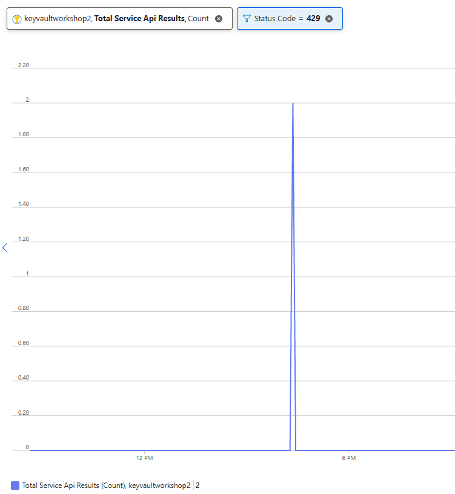
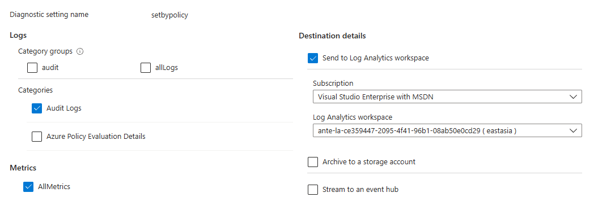
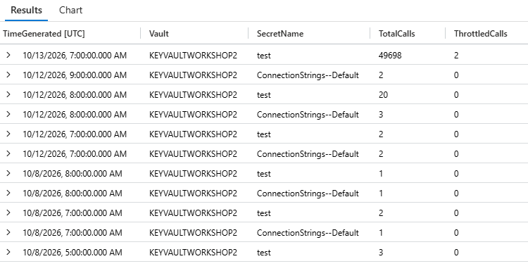
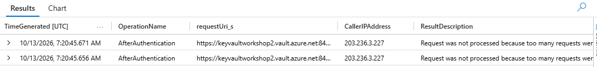

# 04. Key Vault 장애 대응과 Throttling

> 기반 자료: [Key Vault 안정성](https://learn.microsoft.com/azure/reliability/reliability-key-vault), [서비스 한도](https://learn.microsoft.com/azure/key-vault/general/service-limits), [스로틀링 지침](https://learn.microsoft.com/azure/key-vault/general/overview-throttling)

## 0. 한눈에 보는 요약

실패 원인을 나누고, **일시적 오류만 제한적으로 재시도**합니다. 429는 SDK의 지수 백오프와 서버의
Retry-After 지시를 따릅니다. 캐시는 일부 장애 영향을 줄일 수 있지만, 시작 시 비어 있거나 만료된 캐시는
서비스 가용성을 보장하지 않습니다.

## 1. 사전 개념 정리

| 용어 | 의미 |
|---|---|
| Throttling | 서비스 한도를 넘으면 HTTP 429로 클라이언트 속도 감소를 요청하는 동작 |
| 지수 백오프 | 재시도 사이의 대기 시간을 점차 늘리는 방식 |
| Retry-After | 서버가 다음 요청 전 대기 시간을 전달하는 응답 헤더 |
| 작업 시간 예산 | 호출자가 한 작업에 허용하는 전체 시간 |
| Fail closed | 안전한 값을 확보할 수 없을 때 성공처럼 계속하지 않고 해당 기능을 실패 처리 |
| Circuit breaker | 반복 실패 시 잠시 새 호출을 막아 장애 확산을 완화하는 정책 |
| RTO / RPO | 목표 복구 시간 / 허용 가능한 데이터 손실 구간 |

## 2. 오류별 대응

| 증상 | 우선 확인 | 기본 대응 |
|---|---|---|
| 인증 수단 없음 | 실행 환경의 SP·MI 설정 | 신원 설정 수정 |
| 최종 401/인증 실패 | 테넌트·토큰 대상·자격 증명·Conditional Access | 인증 정보와 조직 정책 확인 |
| 403 | 데이터 역할, 전파 대기, 방화벽, Private Endpoint/DNS | 원인 수정; 역할을 무작정 높이지 않음 |
| 404 | 이름·버전·삭제 상태 | 참조 확인; 무한 재시도 금지 |
| 429 | 호출량·전체 열거·동시 시작 | SDK 백오프, 캐시, 부하/동시성 감소 |
| 408 / 일부 5xx | 일시적 네트워크/서비스 장애 | SDK의 제한적 재시도 |
| DNS/TLS/프록시 오류 | 사설 경로, DNS, 인증서 체인 | 환경 수정; TLS 검증 우회 금지 |

Key Vault 인증 과정의 최초 HTTP 401 challenge가 이후 정상 인증으로 이어지는 경우도 있습니다.
로그에서 401 한 건을 봤다고 곧바로 최종 인증 실패로 단정하지 않습니다.

## 3. Secret Throttling 발생 조건

아래 공식 한도는 **해당 리전의 개별 Vault 하나에 적용되는 10초 구간 한도**입니다.

| Secret 작업 | 개별 Vault·리전별 공식 한도 | 초당 평균 환산 |
|---|---:|---:|
| Get Secret, List 등 일반 작업 | 4,000회/10초 | 약 400회/초 |
| Secret 생성·새 버전 저장 | 300회/10초 | 약 30회/초 |

쓰기 한도 300회는 Secret Create, Certificate Import, Key Import의 합산 범주입니다.
구독·리전 전체 한도는 개별 Vault 한도의 5배이므로 일반 작업은 20,000회/10초,
쓰기 범주는 1,500회/10초입니다.
**개별 Vault 한도와 같은 구독·리전의 모든 Vault 합산 한도가 동시에 적용**되므로,
Vault를 여러 개로 나누어도 같은 구독·리전의 합산 한도가 늘어나지는 않습니다.

이를 “항상 초당 400회를 보장한다”거나 “총 4,000회 이하이면 안전하다”로 해석하지 않습니다.
총 요청 수보다 **10초 동안 얼마나 집중되는가**가 중요하며, 다른 앱의 공유 사용량과 SDK 재시도도
함께 고려합니다. 한도를 넘으면 Key Vault는 HTTP 429를 반환합니다.

## 4. Azure Metrics와 감사 로그에서 호출량·429 확인

### 4.1 Azure Metrics에서 429 확인

Azure Monitor 플랫폼 Metrics는 별도 진단 설정 없이 자동 수집됩니다.

1. Azure Portal에서 대상 **Key Vault → Monitoring → Metrics**로 이동합니다.
2. Metric을 **Total Service Api Results** (`ServiceApiResult`)로 선택합니다.
3. Aggregation은 **Count**, 시간 범위는 부하 실행 시점을 포함하도록 설정합니다.
4. **Add filter**에서 `StatusCode = 429`를 선택합니다.
5. 필요하면 `ActivityName`으로 Secret Get을 좁히고, `StatusCode`로 분할하여 성공과 429를 비교합니다.



위 화면은 `Status Code = 429` 필터를 적용하여 실제 throttling 응답을 확인한 예입니다.

함께 볼 Metrics:

| Metric | 확인할 내용 |
|---|---|
| Total Service Api Results | `StatusCode=429` 결과 건수 |
| Total Service Api Hits | 전체 Key Vault API 요청량 |
| Overall Vault Saturation | Vault 처리 용량 사용률. 75% 이상은 경고 기준으로 검토 |
| Overall Service Api Latency | 부하 구간의 평균 지연 증가 |

Metrics의 기본 시간 단위는 1분이므로 콘솔 직후 그래프에 바로 나타나지 않을 수 있습니다.
클라이언트의 `responses_429`와 Metrics의 429 건수는 집계 시점·범위 때문에 정확히 같지 않을 수 있지만
같은 부하 구간에서 증가 방향이 일치해야 합니다.

### 4.2 감사 로그 조회를 위한 Diagnostic settings 구성

Metrics와 달리, 아래 KQL로 요청별 감사 로그를 조회하려면 **미리 로그 수집을 설정**해야 합니다.

1. 대상 **Key Vault → Monitoring → Diagnostic settings**에서 진단 설정을 추가하거나 기존 설정을 엽니다.
2. Logs의 **Audit Logs** (`AuditEvent`)를 선택합니다.
3. **Send to Log Analytics workspace**를 선택하고 대상 구독과 Workspace를 지정한 뒤 저장합니다.
4. 아래 쿼리는 **`AzureDiagnostics` 테이블로 수집되는 환경**을 기준으로 합니다. 대상 테이블 선택이
   제공되면 `Azure diagnostics`를 선택합니다. 리소스별 테이블(`AZKVAuditLogs`)로 수집하는 환경에서는
   테이블과 필드명이 다르므로 쿼리를 그대로 사용할 수 없습니다.



화면의 진단 설정 이름·구독·Workspace는 예시이며 실제 환경에 맞게 지정합니다. **`AllMetrics` 선택은
아래 감사 로그 KQL의 필수 조건이 아닙니다.** Portal의 Metrics 그래프도 별도 진단 설정 없이 확인할 수 있습니다.
로그는 수집 지연이 있을 수 있으며, 설정 전에 발생한 요청은 소급 수집되지 않습니다.

### 4.3 시간대별 Secret 호출 현황

대상 Workspace의 **Logs**에서 다음 KQL을 실행합니다. 최근 7일의 요청을 **1시간 단위·Vault별·Secret별**로
집계하고 전체 집계 건수와 429 건수를 함께 표시합니다.

```kql
AzureDiagnostics
| where TimeGenerated >= ago(7d)
| where ResourceProvider == "MICROSOFT.KEYVAULT"
| where Category == "AuditEvent"
| where OperationName == "SecretGet" or httpStatusCode_d == 429
| extend SecretName = extract(@"/secrets/([^/?]+)", 1, requestUri_s)
| extend SecretName = iff(
    isempty(SecretName), "(Secret 식별 불가)", SecretName)
| summarize
    TotalCalls = count(),
    ThrottledCalls = countif(httpStatusCode_d == 429)
    by bin(TimeGenerated, 1h), Vault = Resource, SecretName
| order by TimeGenerated desc, TotalCalls desc
```



결과 예시에서는 `test`의 `TotalCalls`가 **49,698건**, `ThrottledCalls`가 **2건**으로 확인됩니다.
`TotalCalls`는 **SecretGet 로그와 작업 이름에 관계없이 기록된 429 로그를 포함한 건수**이며,
순수한 SecretGet 성공 건수만을 뜻하지 않습니다. 이번 429는 `AfterAuthentication` 작업으로 기록되어
`OperationName == "SecretGet"`만 필터링하면 제외됩니다. 상태 코드는 `ResultSignature`의 문자열이 아니라
숫자 필드인 `httpStatusCode_d`로 판별합니다.

429 요청 URI에서 Secret 이름을 추출하지 못하면 `(Secret 식별 불가)`로 별도 집계합니다. URI에 Secret
이름이 있어도 실제 작업이 Get이었다고 단정할 수는 없으며, List 등 다른 작업의 429도 포함될 수 있습니다.
또한 **429를 받은 Secret이 반드시 과도한 호출의 원인인 것은 아니므로**, 같은 시간대의 전체 요청량도
함께 비교합니다.

시간은 기본 UTC이며 `1h`를 `1m` 또는 `10s`로 바꾸면 분 또는 10초 단위로 집계할 수 있습니다.
1시간 합계만으로 10초 한도 초과를 판정하지 않습니다. SDK 재시도도 별도 HTTP 요청으로 기록될 수 있습니다.

### 4.4 Throttle된 요청 상세 확인

다음 KQL은 해당 Vault의 **429 요청만** 추출합니다. `KEYVAULTWORKSHOP2`는 실제 Vault 이름으로 변경합니다.

```kql
AzureDiagnostics
| where TimeGenerated >= ago(7d)
| where ResourceProvider == "MICROSOFT.KEYVAULT"
| where Category == "AuditEvent"
| where Resource =~ "KEYVAULTWORKSHOP2"
| where httpStatusCode_d == 429
| project
    TimeGenerated,
    OperationName,
    requestUri_s,
    CallerIPAddress,
    ResultDescription
| order by TimeGenerated desc
```



결과에서 요청 시각, 작업 이름, 요청 URI, 호출자 IP, 오류 설명을 확인합니다. 화면에서 URI나 설명이
잘리면 행 왼쪽의 펼치기 버튼으로 전체 내용을 확인합니다. 이 예시의 작업 이름은 `AfterAuthentication`이며,
이 이름만으로 Entra ID 토큰 발급 한도 문제라고 단정하지 않습니다. Metrics와 비교할 때는 같은 Vault와
같은 시간 범위를 사용합니다.

## 5. .NET SDK의 429 처리

### 5.1 SecretClient 직접 조회

`SecretClient`는 Azure.Core RetryPolicy를 사용합니다. 하나의 `GetSecretAsync`에서 429가 발생하면
애플리케이션이 별도의 무제한 반복문을 만들지 않아도 SDK가 자동 재시도합니다.

별도로 변경하지 않은 `SecretClient`의 기본 재시도 설정은 다음과 같습니다. Configuration Provider가
사용하는 `SecretClient`에도 같은 기본값이 적용됩니다.

| 항목 | 기본값 | 의미 |
|---|---|---|
| `MaxRetries` | 3회 | 최초 요청 포함 최대 4회 시도 |
| `Mode` | `Exponential` | 재시도 대기 시간을 지수적으로 증가 |
| `Delay` | 0.8초 | 서버의 대기 지시가 없을 때 백오프 계산의 기준 |
| `MaxDelay` | 60초 | 서버의 대기 지시가 없을 때 재시도 간 대기 상한 |

서버의 대기 지시가 없다면 대략 0.8초 → 1.6초 → 3.2초를 기준으로 대기하며, 실제 간격에는 무작위
편차가 적용됩니다. 서버가 `Retry-After` 계열 헤더를 제공하면 서버의 대기 지시가 우선하므로,
`MaxDelay=60초`를 모든 경우의 절대 상한으로 해석하지 않습니다.

아래 코드는 **기본값이 아니라 교육 샘플에서 명시적으로 변경한 설정**입니다.

```csharp
var options = new SecretClientOptions
{
    Retry =
    {
        Mode = RetryMode.Exponential,
        Delay = TimeSpan.FromSeconds(1),
        MaxDelay = TimeSpan.FromSeconds(16),
        MaxRetries = 5
    }
};
```

서버가 `Retry-After` 또는 `x-ms-retry-after-ms`를 제공하면 SDK는 서버 대기 지시를 우선 사용하고,
헤더가 없으면 설정한 지수 백오프를 사용합니다. 최대 재시도 후에도 429이면
`RequestFailedException(Status=429)`이 앱으로 전달됩니다.

SDK 바깥에서 또 무제한 retry loop를 감싸지 않습니다. 작업 취소 토큰과 전체 시간 예산을 함께 사용합니다.

### 5.2 IConfiguration과 ReloadInterval

Key Vault Configuration Provider도 내부적으로 같은 `SecretClient`를 사용하므로 최초 로딩과 이후
polling 요청의 429는 먼저 SDK RetryPolicy가 처리합니다. 재시도는 **개별 List/Get HTTP 요청 단위**로
적용되며, 초기 로딩 전체를 세 번 다시 실행하는 의미는 아닙니다. 요청 수, 응답 시간, 서버의 대기 지시에
따라 전체 로딩 시간이 달라지므로 앱 시작 대기 시간이 약 5.6초로 고정되는 것도 아닙니다.

이름 필터를 사용해도 변경 확인을 위한 Secret 속성 목록 조회는 수행되므로, Access Policy 환경에서는
직접 조회의 Get과 달리 Configuration Provider에 List + Get 권한이 필요합니다.

| 발생 시점 | SDK 재시도 후에도 429일 때 |
|---|---|
| 앱 시작의 최초 `Build()` / `Load()` | 예외가 호출자에게 전달됨; 처리하지 않으면 시작 실패 |
| `ReloadInterval`의 백그라운드 polling | 공급자가 예외를 무시하고 기존 `Data`를 유지 |

**앱 시작 시 최초 로딩 실패**

`ReloadInterval`은 초기 로딩을 생략하거나 나중으로 미루는 설정이 아닙니다. 예를 들어 30분으로
설정해도 앱 시작 시에는 즉시 Key Vault에 접근하여 설정을 로딩합니다.

이때 재시도 횟수와 간격은 **Provider에 전달한 `SecretClient`의 `Retry` 설정**을 따릅니다.

| 설정 기준 | 재시도 횟수 | 서버의 대기 지시가 없을 때의 기준 간격 |
|---|---|---|
| SDK 기본값 | 3회 — 최초 요청 포함 최대 4회 | 약 0.8초 → 1.6초 → 3.2초 |
| §5.1 교육 샘플 설정 | 5회 — 최초 요청 포함 최대 6회 | 약 1초 → 2초 → 4초 → 8초 → 16초 |

실제 간격에는 무작위 편차가 적용됩니다. 429 응답에 `Retry-After` 또는 `x-ms-retry-after-ms`가 있으면
위 간격보다 **서버의 대기 지시가 우선**합니다. 이 횟수는 초기 로딩 전체가 아니라 개별 List/Get 요청에
적용되므로 앱 시작까지의 총 대기 시간을 뜻하지 않습니다. `ReloadInterval=30분`이어도 초기 로딩의
재시도를 30분마다 수행하는 것은 아닙니다.

```text
앱 시작 → 즉시 초기 로딩 → 429 → SDK 재시도
    ├─ 성공: 설정값을 메모리에 보관하고 앱 시작, 이후 백그라운드 갱신
    └─ 재시도 소진: 예외가 시작 코드로 전달, 처리하지 않으면 앱 시작 실패
```

새 프로세스에는 아직 사용할 메모리 값이 없습니다. 따라서 Vault 장애나 429 중에 기존 인스턴스는
동작하더라도 새 배포·재시작·스케일아웃 인스턴스는 시작하지 못할 수 있습니다. SDK 재시도 정책을
시작 시간 예산에 맞추고, 동시 시작을 분산하며, 새 인스턴스의 초기 로딩과 준비 상태 확인이 끝날 때까지
기존 인스턴스를 유지하도록 배포를 설계합니다. 예외를 잡고 필수 설정 없이 계속 시작하는 것은 해법이 아닙니다.

**최초 로딩 성공 후 백그라운드 reload 실패**

앱은 평소에도 `IConfiguration`에 보관된 메모리 값을 읽습니다. reload가 실패한 뒤 별도 캐시로 전환하거나,
`Configuration["키"]`를 읽을 때마다 Vault 조회를 시도하는 구조가 아닙니다.

```text
최초 로딩 성공 → 값 A를 메모리에 보관 → 앱은 A 사용
    ↓
ReloadInterval 도래 → Key Vault 조회 → SDK 재시도까지 실패
    ↓
기존 값 A 유지 → 앱은 계속 A 사용
    ↓
이후 polling 성공 → 변경된 값 B 반영 → 앱은 B 사용
```

백그라운드 갱신에 실패해도 기존 설정값은 계속 읽을 수 있지만 새 값은 반영되지 않고 reload notification도
발생하지 않습니다. 공급자는 다음 `ReloadInterval`에 다시 polling합니다. 앱이 살아 있다는 사실만으로
Secret 최신성이 보장되지는 않으므로 429, 마지막 성공 갱신 시점, 설정 최신성을 별도로 관측해야 합니다.

reload 실패 자체가 기존 `Configuration["키"]` 읽기에 예외를 발생시키지는 않습니다. 다만 **설정값을
읽을 수 있는 것과 그 자격 증명이 실제로 유효한 것은 별개**입니다. DB 비밀번호가 변경되어 이전 값이
폐기되었다면 Configuration은 A를 반환하더라도 실제 DB 연결은 실패할 수 있습니다. 회전 시 기존 자격
증명의 유효 기간과 앱의 갱신 지연을 함께 고려합니다.

## 6. 캐시가 있을 때와 없을 때

이 절은 `SecretClient`를 직접 조회하는 교육 샘플의 앱 TTL 캐시 정책입니다. §5.2의 Configuration
Provider가 reload 실패 시 기존 값을 유지하는 동작과 구분합니다.

| 상태 | 이번 샘플의 동작 |
|---|---|
| 유효한 캐시 존재 | Vault 호출 없이 사용 가능 |
| 최초 시작·캐시 없음 | Vault 조회 실패 시 기능 실패 |
| TTL 경과 | 갱신 필요; 실패하면 이전 값을 사용하지 않음 |
| Secret 만료 | 캐시 TTL이 남아도 사용하지 않음 |
| 장애 복구 | 다음 조회가 성공하면 정상 캐시 갱신 |

교육 샘플은 보수적으로 fail closed를 사용합니다. 업무별로 stale 값을 잠시 허용하려면 최대 허용 시간,
자격 증명 실제 유효성, 보안 승인, 알림, 회전 충돌 처리까지 정의해야 합니다.
“장애이면 appsettings.json의 운영 암호로 대체”는 사용하지 않습니다.

같은 이름에 대한 성공한 갱신은 한 번으로 합쳐지지만, 반복 실패 시 대기자들이 차례로 다시 시도할 수 있습니다.
실제 트래픽에서는 rate limiter/circuit breaker와 갱신 실패 후 재시도 간격을 추가 설계합니다.

## 7. 플랫폼 가용성과 앱 DR을 분리합니다

Key Vault는 지원 리전에서 가용 영역 중복성을 자동 제공합니다. 이는 모든 지역 장애가 즉시 해결된다는 뜻은 아닙니다.

Microsoft 관리 지역 장애 조치는 적용 가능한 paired region에서 제공되며, Microsoft가 판단하여 시작하고
상당한 지연 후 best-effort로 진행될 수 있습니다. 모든 리전에 동일하게 제공되는 것도 아닙니다.
고정 RTO/RPO를 보장한다고 설명하지 않습니다.

중요 업무의 별도 다중 리전 Vault 설계에는 값 동기화, 버전/만료 일치, 권한, 네트워크, 회전,
전환 판단, 복귀 절차가 필요합니다. 엔드포인트 두 개만 설정해 두면 자동으로 안전해지는 것이 아닙니다.

Soft delete와 purge protection은 삭제 사고 대응입니다. 서비스 장애 대응과 구분합니다.

## 8. 실습 연결

[Lab 04](../labs/04-resilience/README.md)에서는 강사가 교육 전용 격리 Vault에 부하를 발생시키고,
참가자는 별도의 .NET 10 프로젝트로 다음을 확인합니다.

- `SecretClient.GetSecretAsync` 내부의 자동 재시도와 429/Retry-After
- 최초 로딩 성공 후 `ReloadInterval=10초` polling에서 429가 발생할 때 기존 값 유지와 다음 주기 재시도
- Azure Metrics의 `Total Service Api Results`에서 `StatusCode=429` 확인

운영·공용 Vault에서는 부하를 발생시키지 않으며, 이 실습으로 실제 Azure 지역 장애 조치를 검증했다고
주장하지 않습니다.

## 학습 체크리스트

- [ ] Secret 읽기·쓰기의 10초 구간 한도를 설명할 수 있습니다.
- [ ] 403과 429에 서로 다른 조치를 선택할 수 있습니다.
- [ ] SDK 자동 재시도와 애플리케이션의 무제한 retry loop를 구분할 수 있습니다.
- [ ] SDK 기본 재시도 설정과 `ReloadInterval`의 역할을 구분할 수 있습니다.
- [ ] 최초 로딩 실패가 신규·재시작 인스턴스의 시작에 영향을 주는 이유를 설명할 수 있습니다.
- [ ] Configuration polling 실패 중 기존 값이 유지되는 이유를 설명할 수 있습니다.
- [ ] 기존 설정값을 읽을 수 있어도 실제 DB/API 인증은 실패할 수 있음을 설명할 수 있습니다.
- [ ] Metrics에서 429와 Vault saturation을 확인할 수 있습니다.

## 참고 링크

- [Key Vault 안정성](https://learn.microsoft.com/azure/reliability/reliability-key-vault)
- [서비스 한도](https://learn.microsoft.com/azure/key-vault/general/service-limits)
- [스로틀링 대응](https://learn.microsoft.com/azure/key-vault/general/overview-throttling)
- [Key Vault 지원 Metrics](https://learn.microsoft.com/azure/azure-monitor/reference/supported-metrics/microsoft-keyvault-vaults-metrics)
- [Key Vault 경고 구성](https://learn.microsoft.com/azure/key-vault/general/alert)
- [Azure SDK RetryOptions 기본값](https://github.com/Azure/azure-sdk-for-net/blob/main/sdk/core/Azure.Core/src/RetryOptions.cs)
- [Key Vault Configuration Provider 구현](https://github.com/Azure/azure-sdk-for-net/blob/main/sdk/extensions/Azure.Extensions.AspNetCore.Configuration.Secrets/src/AzureKeyVaultConfigurationProvider.cs)
