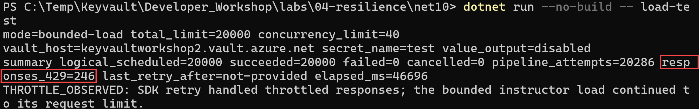
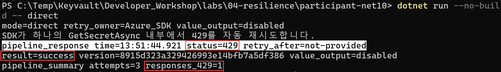

# Lab 04. 실제 Key Vault Throttling과 재시도

> 목표: 실제 Azure Key Vault에서 429를 발생시키고, SecretClient와 Configuration Provider가 이를 처리하는 방식을 확인합니다.  
> 예상 시간: 30분  
> 출처: [서비스 한도](https://learn.microsoft.com/azure/key-vault/general/service-limits), [스로틀링 지침](https://learn.microsoft.com/azure/key-vault/general/overview-throttling)

## 0. 역할과 안전 범위

이 Lab은 강사가 제공한 **교육 전용 격리 Vault와 읽기 전용 SP**를 사용합니다.
운영·공용 Vault에서는 실행하지 않습니다. Secret 값은 어떤 프로젝트에서도 출력하지 않습니다.

| 역할 | 프로젝트 | 수행 내용 |
|---|---|---|
| 강사 | `net10` | 같은 Secret에 제한된 부하를 발생시켜 429 상황 유지 |
| 참가자 | `participant-net10` | 직접 조회와 Configuration polling의 SDK 자동 재시도 관찰 |

강사용 부하는 다음 값으로 제한됩니다.

| 항목 | 기본값 | 코드 최대값 |
|---|---:|---:|
| 전체 논리 요청 | 20,000 | 20,000 |
| 동시 worker | 40 | 40 |
| SDK 최대 재시도 | 3 | 3 |
| 네트워크 요청 제한 시간 | 10초 | 10초 |

강사용 프로젝트는 중간에 429가 SDK 재시도로 복구되어도 20,000회 범위 안에서 부하를 계속합니다.
최종적으로 복구되지 않는 요청이 발생하면 신규 요청을 취소하고 오류 코드 2로 종료합니다.

## 1. Throttling 발생 조건

공식 한도는 초당 고정값이 아니라 **Vault·리전 기준 10초 구간**입니다.

| Secret 작업 | Vault·리전별 한도 | 초당 평균 환산 |
|---|---:|---:|
| Get Secret, List 등 일반 작업 | 4,000회/10초 | 약 400회/초 |
| Secret 생성·새 버전 저장 | 300회/10초 | 약 30회/초 |

쓰기 한도 300회는 Secret Create, Certificate Import, Key Import의 합산 범주입니다.
구독·리전 전체 한도는 개별 Vault의 5배입니다. 총 요청이 많아도 천천히 실행하면 429가 없을 수 있으며,
짧은 10초 구간에 요청이 집중되어야 합니다.

## 2. 프로젝트 빌드

각 프로젝트는 자기 폴더에 소스를 포함합니다.

```powershell
# 워크숍 루트 폴더
$InstructorProject = ".\labs\04-resilience\net10\KeyVaultResilience.Net10.csproj"

$ParticipantProject = ".\labs\04-resilience\participant-net10\KeyVaultRetry.Participant.Net10.csproj"

dotnet build $InstructorProject
if ($LASTEXITCODE -ne 0) { throw "Instructor project build failed" }

dotnet build $ParticipantProject
if ($LASTEXITCODE -ne 0) { throw "Participant project build failed" }
```

## 3. 공통 접속 설정

강사와 참가자는 같은 교육용 Vault·Secret을 사용합니다. 참가자별 SP에는 해당 Secret 읽기 권한이 필요합니다.
RBAC 환경에서는 `Key Vault Secrets User`를 사용합니다. Access Policy 환경에서는 직접 조회는
Secret Get, Configuration Provider는 **List + Get**이 필요합니다.

```powershell
$env:KEY_VAULT_URL = "https://<training-vault>.vault.azure.net/"
$env:KV_SECRET_NAME = "test"
$env:AZURE_TENANT_ID = "<tenant-guid>"
$env:AZURE_CLIENT_ID = "<application-client-guid>"

$secureSecret = Read-Host "Client Secret Value" -AsSecureString
try {
    $env:AZURE_CLIENT_SECRET = (
        New-Object System.Net.NetworkCredential -ArgumentList "", $secureSecret
    ).Password
}
finally {
    $secureSecret.Dispose()
}
```

Client Secret ID가 아니라 **Value**를 사용합니다. `az login`이나 구독 권한은 필요하지 않습니다.

## 4. 사전 확인

### 4.1 강사용 프로젝트

```powershell
dotnet run --project $InstructorProject --no-build -- probe
if ($LASTEXITCODE -ne 0) { throw "Instructor probe failed" }
```

### 4.2 참가자 직접 조회

강사 부하를 시작하기 전에 한 번 실행하여 정상 접근을 확인합니다.

```powershell
dotnet run --project $ParticipantProject --no-build -- direct
if ($LASTEXITCODE -ne 0) { throw "Participant direct probe failed" }
```

## 5. 강사 — 429 부하 발생

강사 PowerShell에서 실행합니다.

```powershell
$env:KV_LOAD_TOTAL_REQUESTS = "20000"
$env:KV_LOAD_CONCURRENCY = "40"

dotnet run --project $InstructorProject --no-build -- load-test
$LASTEXITCODE
```

주요 출력:

| 출력 | 의미 |
|---|---|
| `logical_scheduled` | 앱이 시작한 Secret Get 수 |
| `succeeded` | SDK 재시도 후 최종 성공한 논리 요청 |
| `failed` | SDK 재시도 후에도 실패한 논리 요청 |
| `pipeline_attempts` | 최초 요청과 SDK 재시도를 포함한 HTTP 파이프라인 시도 |
| `responses_429` | 실제 관찰한 429 응답 |
| `last_retry_after` | 마지막 429의 서버 대기 헤더 |

```text
summary logical_scheduled=... succeeded=... pipeline_attempts=... responses_429=...
THROTTLE_OBSERVED: SDK retry handled throttled responses...
```

강사 부하에서 실제 429가 발생한 출력 예시입니다. 빨간 테두리는 줄바꿈되어 표시된
**`responses_429=246`**을 강조합니다.



이 실행에서는 논리 요청 20,000개가 모두 성공했고(`succeeded=20000`, `failed=0`),
그 과정에서 HTTP 429 응답 246건이 관찰되었습니다. **최종 실패가 0건이어도 중간에 429가 발생할 수
있으며**, SDK 재시도로 복구되면 최종 성공으로 집계됩니다. `THROTTLE_OBSERVED`는 실제 429가 관찰되었음을
나타냅니다. 요청 수·429 건수·실행 시간은 실행 환경과 다른 트래픽에 따라 달라집니다.

`pipeline_attempts - logical_scheduled`에는 429 재시도 외에 Key Vault challenge 인증의
401 후 재전송이 포함될 수 있습니다.

## 6. 참가자 A — SecretClient 직접 조회

강사 부하가 실행 중일 때 참가자가 실행합니다.

```powershell
dotnet run --project $ParticipantProject --no-build -- direct
$LASTEXITCODE
```

참가자 코드는 `GetSecretAsync`를 **한 번만 호출**합니다. 별도의 `while` 재시도 루프를 만들지 않습니다.

```csharp
Retry.Mode = RetryMode.Exponential;
Retry.Delay = TimeSpan.FromSeconds(1);
Retry.MaxDelay = TimeSpan.FromSeconds(16);
Retry.MaxRetries = 5;
```

처리 순서:

1. `SecretClient`가 Get 요청을 보냅니다.
2. 429이면 SDK RetryPolicy가 `Retry-After` 또는 `x-ms-retry-after-ms`를 확인합니다.
3. 서버 헤더가 없으면 설정한 지수 백오프를 사용합니다.
4. 최대 재시도 안에 성공하면 원래 `GetSecretAsync`가 정상 반환됩니다.
5. 끝까지 429이면 `RequestFailedException`의 `Status=429`가 앱으로 전달됩니다.

`RetryObservationPolicy`는 SDK 내부 재시도마다 다음 형태로 출력합니다.

```text
pipeline_response time=16:30:01.123 status=429 retry_after=1000
```

Secret 값은 출력하지 않고 성공한 버전 ID만 표시합니다.
참가자 출력에서는 혼동을 피하기 위해 초기 인증 challenge의 401 응답과 `responses_401` 항목을
표시하지 않습니다. `pipeline_summary`의 `attempts`에는 인증 후 재전송도 포함되므로, 429가 없어도
2 이상일 수 있습니다. 실제 최종 인증 실패는 `AUTH_FAILED` 또는 `KEY_VAULT_ERROR status=401`로 표시합니다.

참가자가 429를 받은 뒤 SDK 재시도로 성공한 실제 출력 예시입니다. 빨간 테두리는
**`status=429`**, **`result=success`**, **`responses_429=1`**을 강조합니다.



이 실행에서는 하나의 `GetSecretAsync` 호출 도중 429 응답이 한 번 발생했지만, SDK가 재시도하여
최종적으로 Secret 조회에 성공했습니다. `retry_after=not-provided`는 서버의 대기 헤더가 없었다는 뜻이며,
재시도를 하지 않았다는 의미가 아닙니다. 이 경우 설정한 지수 백오프를 사용합니다.
`attempts=3`은 429가 세 번 발생했다는 뜻이 아니며, 초기 인증 challenge 후 재전송도 포함합니다.

## 7. 참가자 B — IConfiguration과 ReloadInterval

이 실습은 **최초 로딩 성공 후 백그라운드 갱신에서 429가 발생하는 상황**을 확인합니다.

1. 강사 부하를 중지한 상태에서 참가자 프로젝트를 먼저 시작합니다.
2. `initial_load=success`를 확인합니다.
3. 참가자 프로그램이 실행 중인 상태에서 강사가 5절의 부하를 시작합니다.
4. 참가자는 10초 단위 polling의 429와 기존 값 유지 여부를 관찰합니다.

참가자 PowerShell:

```powershell
$env:KV_RELOAD_SECONDS = "10"
$env:KV_OBSERVE_SECONDS = "60"

dotnet run --project $ParticipantProject --no-build -- configuration
$LASTEXITCODE
```

Configuration Provider도 내부적으로 같은 `SecretClient`를 사용하므로 각 polling 요청에서 먼저
SDK 자동 재시도가 수행됩니다.

`SingleSecretManager`는 값을 가져올 대상을 지정한 Secret 하나로 제한하지만,
Configuration Provider의 변경 확인 과정에서는 Vault의 Secret 속성 목록을 먼저 조회합니다.
Configuration 키는 실제 Secret 이름을 그대로 사용합니다. 예를 들어 `KV_SECRET_NAME=test`이면
`configuration[settings.SecretName]`은 `configuration["test"]`의 메모리 값을 읽습니다.

| 시점 | SDK 재시도 후에도 429일 때 |
|---|---|
| 최초 `ConfigurationBuilder.Build()` | 예외가 호출자에게 전달되어 시작 실패 |
| `ReloadInterval` 백그라운드 polling | 공급자가 오류를 무시하고 기존 설정값 유지 |

백그라운드 polling 실패 시:

- 기존 `IConfiguration` 값은 계속 읽을 수 있습니다.
- 변경된 Secret은 반영되지 않습니다.
- `GetReloadToken()` 알림도 발생하지 않습니다.
- 공급자는 다음 10초 주기에 다시 polling합니다.
- `RetryObservationPolicy` 출력으로 429는 확인할 수 있습니다.

예상 관찰:

```text
initial_load=success value_present=true value_output=disabled
pipeline_response ... status=429 retry_after=...
watch ... value_present=true reload_notifications=0 observed_429=1
```

공급자가 오류를 무시한다는 것은 장애가 해결되었다는 뜻이 아닙니다. 앱의 기존 값과 Secret 최신성,
429 횟수, 마지막 성공 갱신 시점을 운영에서 별도로 관측해야 합니다.

## 8. 소스 확인

| 소스 | 확인할 부분 |
|---|---|
| [net10/ResilienceDemo.cs](net10/ResilienceDemo.cs) | 강사용 20,000회·40 worker 부하 |
| [participant-net10/Program.cs](participant-net10/Program.cs) | 직접 조회·Configuration 갱신·SDK 재시도 관찰 |

참가자 소스에는 SDK와 Configuration Provider의 책임 경계를 설명하는 한글 주석이 포함되어 있습니다.

## 9. 종료와 정리

```powershell
Remove-Item Env:AZURE_CLIENT_SECRET -ErrorAction SilentlyContinue
Remove-Item Env:KV_LOAD_TOTAL_REQUESTS -ErrorAction SilentlyContinue
Remove-Item Env:KV_LOAD_CONCURRENCY -ErrorAction SilentlyContinue
Remove-Item Env:KV_RELOAD_SECONDS -ErrorAction SilentlyContinue
Remove-Item Env:KV_OBSERVE_SECONDS -ErrorAction SilentlyContinue
```

## 완료 체크리스트

- [ ] Secret 읽기·쓰기의 10초 구간 한도를 설명할 수 있습니다.
- [ ] 직접 조회에서 SDK가 429를 자동 재시도하는 것을 확인했습니다.
- [ ] Configuration polling 실패 중에도 기존 값이 유지되는 것을 확인했습니다.
- [ ] SDK 재시도와 애플리케이션의 무제한 retry loop를 구분할 수 있습니다.
